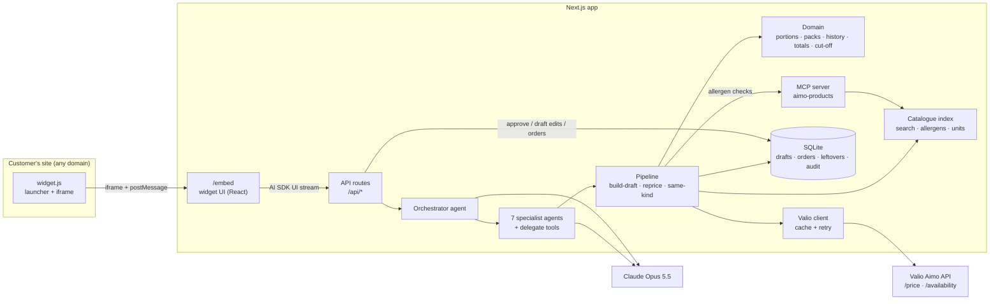
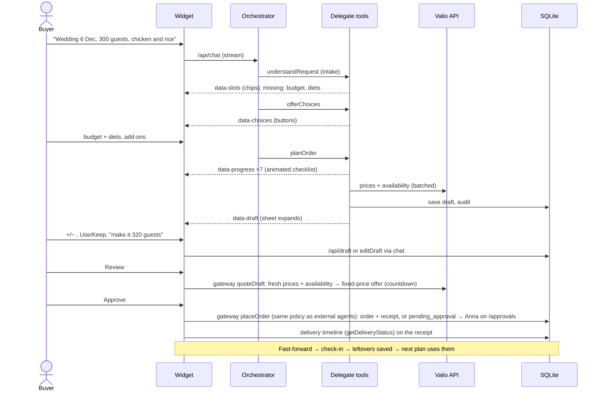

# Architecture

Aimo Planner is a drop-in ordering assistant for Valio Aimo B2B customers. A buyer describes an event in plain words. Agents turn that into a priced, stock-checked, allergen-safe order draft, corrected by the customer's own leftover history. The buyer edits it, approves it, and it is submitted (simulated).

The guiding rule: **agents reason; code computes.** Language models interpret requests, plan menus and pick between candidate products. Every price, stock figure, quantity, allergen verdict and history number comes from deterministic code over real data.

## System overview

## Layers

| Layer | Path | Responsibility |
|---|---|---|
| Embed | `public/widget.js` | One `<script>` tag. It injects a launcher and an iframe to `/embed`, resizes on `postMessage` (origin-pinned both ways), and exposes `window.AimoWidget.open()`. |
| Widget UI | `src/ui/*`, `src/app/embed` | Chat, slot chips, choice buttons, planning checklist, the order-draft working sheet, review, receipt, My orders and check-in. `useLiveSession` talks to the backend; `useFixtureSession` (`?fixture=1`) is a scripted, no-key fallback. |
| API | `src/app/api/*` | `chat` (agent stream), `draft` (buyer edits), `order/offer`, `order/place`, `order/status` (the widget as a gateway client: quoteDraft → placeOrder, the only submit path), `orders/[id]/delivery`, `orders`, `audit`, `checkin`, `demo`. All inputs are validated with zod. |
| Server services | `src/server/*` | Check-in saving (prefilled with short deliveries), the demo clock (fast-forward, next delivery step) and reset. Ordering lives in the gateway only: `placeOrder` re-checks availability, cut-off, prices and allergens with fresh Valio data inside a race-safe transaction, for the widget and external agents alike. |
| Delivery (simulated) | `src/gateway/delivery.ts`, `deliveries.ts` | Deterministic timeline per order from the demo clock: received → confirmed → picking → out for delivery (ETA window) → delivered, a supplier track for terminal lines, late risk near the cut-off, and short deliveries for low-reliability lines (seeded by order id). Delivered quantities are persisted once and audited. |
| Agents | `src/mastra/agents/*` | The orchestrator plus intake, menu, product, allergen, pricing, history and order specialists, all on `claude-opus-5-5` with per-agent effort. |
| Delegate tools | `src/mastra/tools/*` | `understandRequest`, `offerChoices`, `askDiets`, `planOrder`, `editDraft` and `checkIn`. `askDiets` asks how many guests have each named diet (5 / 10 / 20 / about 10% / everyone) or offers common allergies; code then sizes each diet variant by its count (`src/domain/diets.ts`). These are the only things the orchestrator can call; each is owned by one specialist. |
| Pipeline | `src/mastra/pipeline/*` | `buildDraft`: menu → quantities → search → product pick → allergen screen (via MCP) → price and stock → same-kind substitution and stock split → history → totals. |
| Domain (pure) | `src/domain/*` | Portion rules, rounding up to whole packs, leftover-history ratios, price range and totals, draft mutations, effective cut-off. |
| Catalogue | `src/catalog/*`, `data/catalog.index.json` | An index of 17,546 products built from the 87 MB raw file. MiniSearch over Finnish and English names; allergens derived from ingredient text and names; pack sizes per sales unit. |
| Agent gateway | `src/gateway/*` | What external purchasing agents can do: the widget's event flow (plan, edit, check out, leftovers) on the same pipeline, price and availability lookup, fixed-price offers (15 min, never past cut-off), orders with requote on any change, a deterministic per-customer authority policy, human approvals, API-key identity. Offers and approvals in SQLite, every step audited. |
| MCP | `src/mcp/*`, `src/app/api/mcp` | The `aimo-gateway` MCP server: tool registry (catalogue, pricing, offers, orders, policy, `chatWithAimo`), resources `aimo://policy` and `aimo://playbook`, stdio and bearer-protected Streamable HTTP. The pipeline's allergen step calls its `checkAllergens` over stdio. See [MCP.md](MCP.md) and [docs/CONNECT.md](docs/CONNECT.md). |
| Approvals | `src/app/approvals`, `src/app/api/approvals/*` | The human approver's page: the only way to approve an agent's order outside its authority. No login in this prototype: keep it on localhost (see MCP.md, security model). |
| Valio | `src/valio/*` | Batched (≤1000), cached (10 min), retrying client for `/api/price` and `/api/availability`. Falls back to stale cache when Valio is down. |
| Data | `src/db/*` | SQLite via Drizzle: drafts, orders and receipts, order lines, leftovers, audit log, demo clock. `npm run seed` creates the demo customer and 8 past events. |
| Contracts | `src/contracts.ts` | The single set of shared types used by every layer, including the `data-*` stream parts. |

## Agents and their jobs

| Agent | Calls the model for | Deterministic work it owns |
|---|---|---|
| Orchestrator | Talking to the buyer in their language (at most 3 sentences), choosing the next tool | none (never touches data) |
| Intake | Extracting date, guests, menu, budget and diets from free text | Validating dates and guest counts, cut-off at intake |
| Menu | Turning the menu into components with portion categories and diet variants | Portion maths, diet rules for shared items |
| Product | Picking the best candidate per component; handling "cheaper" and swaps | Candidate ranking (pack granularity, reliability) |
| Allergen | Choosing between unknown-allergen fallbacks (rare) | Allergen screening via MCP; unknown is never safe |
| Pricing | none | Prices, stock, effective cut-off, same-kind substitution, stock split |
| History | Parsing the check-in reply ("5 kg chicken left, rice ran out") | Leftover ratios with fallbacks and recency weighting, clamped to stock |
| Order | Turning typed edits into draft changes | Applying changes, re-pricing, budget |

Every tool call writes an audit entry with the acting specialist, which the decision log shows.

## Request flow (happy path)

## Safety and control

- **One set of rules for every agent.** In the widget, only a buyer click submits (no widget agent tool can), and that click is the gateway's `placeOrder` under the server-side identity `aimo-widget`, so the chef's widget and external MCP agents get the same offers, authority policy and human sign-off. Orders outside the authority wait for a human on `/approvals` (no MCP tool can approve). The only difference: the widget has a human in the loop, so the buyer's per-line tick counts as the sign-off for an unverifiable allergen line; external agents can't do that. `placeOrder` re-checks everything and returns a requote instead of changing anything silently. A double click is idempotent.
- **Allergens.**
  - Products with no real ingredient data are "unknown" and never pass a constraint.
  - Shared items must satisfy every diet group.
  - Diet coverage only counts one way: lactose-free never covers a milk allergy.
  - Unknown lines need a per-line tick in Review, which is recorded in the audit log.
- **No silent changes.** Substitutions are tagged with a reason in the buyer's language. Stock shortfalls are split or offered as choices. History notes need Use or Keep. Budget overruns are flagged.
- **Valio failure.** The client retries, then serves stale cache. Review re-quotes and Approve refuses stale prices or availability with a plain message, and the route returns 503 when nothing is cached.

## Key data interpretations

- **Sold-by-kg products:** Valio prices them per kg. A "pack" is the approximate piece weight, so the line price is per-kg price × piece weight. Stock is in kg, and lot sizes are normalised to packs at index build.
- **Order cut-off:** Valio's `closingTime` applies to the earliest `availableDate`. The cut-off for the requested date is the requested date minus the same lead time.
- **History:** leftovers are stored per line as a ratio (+ left over, − short). The fallbacks are same product → same category and event type → same category, weighted toward recent events (half-life about 6 months). A note is shown only when it changes the pack count.

## Running and testing

See [README.md](README.md). Summary: `npm run seed`, `npm run dev`, open `/demo-host?demo=1`. `npm test` runs 225 tests. `scripts/gateway-demo.ts` runs an external agent against the gateway over MCP. `scripts/agent-smoke.ts` runs a live end-to-end conversation.
