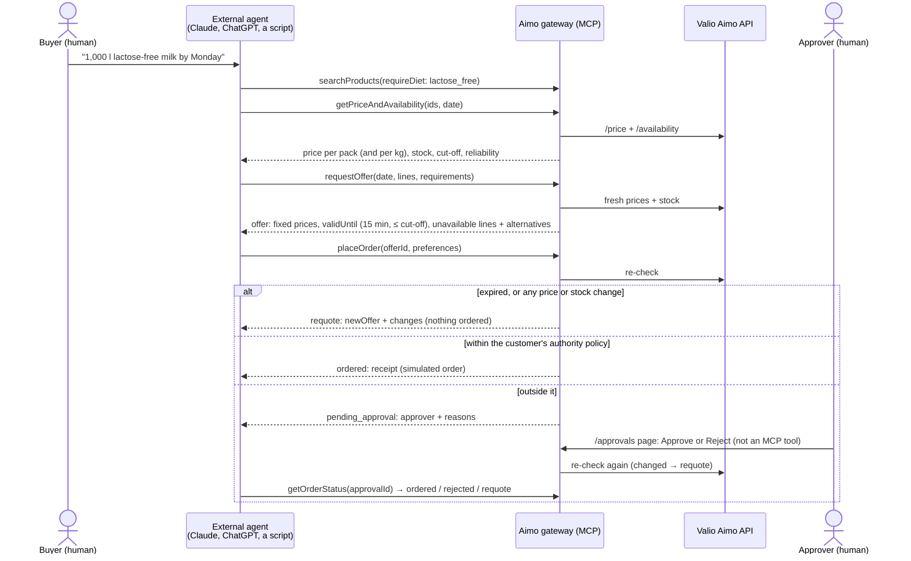
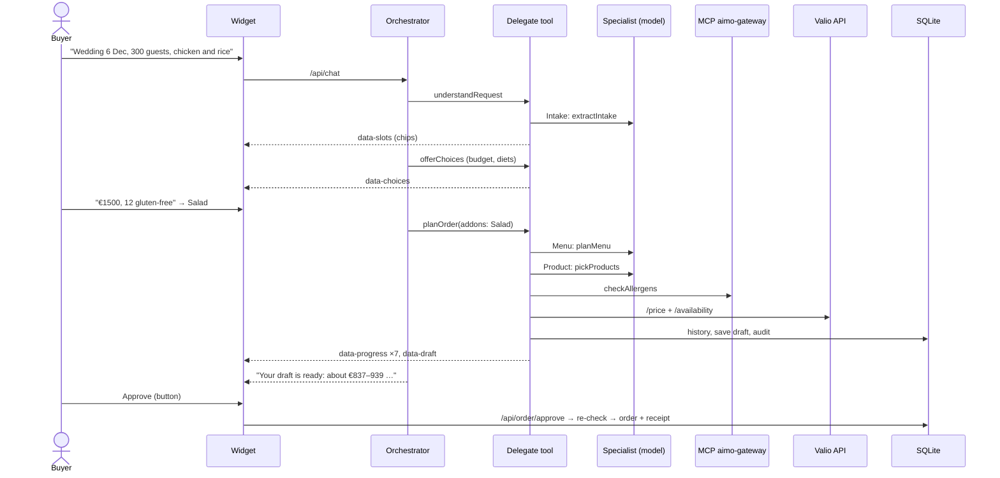

# Orchestrator, tools and MCP

How Aimo Planner's agents are wired: the agent gateway that external purchasing agents use over MCP (section 5), who talks to the buyer in the widget, which tools exist and who owns them, and the steps the planning pipeline runs. For the wider system, see [ARCHITECTURE.md](ARCHITECTURE.md).

## 1. The big picture

**The rule:** agents reason, code computes. The orchestrator can only call the five delegate tools. Specialists use the model only where judgment is needed. Every price, stock figure, quantity, allergen verdict and history number comes from code over real data. In the widget, no agent can submit an order; only the buyer's **Approve** button can. External purchasing agents order through the gateway (section 5), where code applies the customer's authority policy and a human signs off the rest.

## 2. Orchestrator tools

These are the only tools the orchestrator sees (`src/mastra/tools/*`). Each one is typed with zod, writes `data-*` stream parts the widget renders, and records its steps in the audit log under the owning specialist.

| Tool | Owner | What it does | UI it drives |
|---|---|---|---|
| `understandRequest` | Intake | Extracts date, guests, menu, budget and diets from free text in any language. Validates them (date at least tomorrow, guests 1–5000, cut-off). Only works before a draft exists. | `data-slots`: the slot chips |
| `offerChoices` | Orchestrator | Shows 2–6 quick-reply buttons plus an optional free-text field: missing slots, add-ons, stock shortfalls, substitutions. | `data-choices`: the buttons |
| `planOrder` | Menu → Product → Allergen → Pricing → History → Order | Runs the planning pipeline (section 4) and builds the priced draft. Called again with a new `deliveryDate` to re-plan. | `data-progress` (the animated checklist), then `data-draft` (the sheet) |
| `editDraft` | Order (calls Product, Allergen and Pricing as needed) | Turns typed changes into draft edits: set packs, remove, scale guests, history choice, swap, add, top-up for the remainder. Re-prices and reports problems. | `data-draft` with a diff (changed rows flash) |
| `checkIn` | History | Parses "about 5 kg chicken left, rice ran out" into a left / short amount per line. Saves nothing until the buyer confirms. | `data-checkin`: the editable table |

Buyer clicks (+/−, Use/Keep, remove, Approve, check-in Confirm) don't go through the model. They call `/api/draft`, `/api/order/approve` and `/api/checkin` directly.

## 3. Specialist agents

All run on `claude-opus-5-5` by default (`src/mastra/agents/*`); set `AIMO_MODEL` to another Mastra model-router string (e.g. `openai/<model>`) to switch. The effort and prompt-cache settings are only sent to Anthropic models. Model calls are injected through `src/mastra/specialists.ts`, so tests can stub them.

| Specialist | Model call (judgment) | Deterministic work done on its behalf | Effort |
|---|---|---|---|
| Intake | `extractIntake`: free text → slots | Date and guest validation, cut-off at intake | low |
| Menu | `planMenu`: dishes → components (portion category, diet variants, "needed for cooking" items) | Portion maths, diet rules for shared items, dropping orphan variants | medium |
| Product | `pickProducts`: best candidate per component, all components in one call | Candidate ranking (pack granularity, reliability, price for "cheaper") | medium |
| Allergen | `chooseUnknownFallback`: only when several candidates have unknown allergens | Allergen screening **via MCP**; unknown is never safe; diet coverage is one-way | low |
| Pricing | none | Valio prices and stock, effective cut-off, same-kind substitution, stock split or cap | low |
| History | `parseCheckIn`: leftover reply → numbers | Leftover ratios with fallbacks and recency weighting, clamped to stock | low |
| Order | `interpretEdit`: typed change → draft intents | Applying intents, re-pricing, budget, conflict detection | low |

A full plan costs about 3 model calls (menu, one product pick, plus the orchestrator turn) and takes about 20 s.

## 4. The planning pipeline (`planOrder` → `buildDraft`)

`src/mastra/pipeline/build-draft.ts`. Each step emits a progress event (the checklist in the widget) and writes audit entries.

What the steps guarantee:
- **Quantities:** always rounded up to whole packs, using minimum order steps normalised to packs.
- **Products sold by the kilo:** line price = per-kg price × piece weight, and stock is compared in kg.
- **Substitutes:** must be the same kind of product (name terms or category) and pass the same allergen constraints. They are never silent and always carry a reason in the buyer's language.
- **Resilience:** if a specialist call fails, the pipeline degrades (for example to the best catalogue match) instead of failing the whole plan. If Valio is down, the client serves cached prices and Approve refuses stale ones.

## 5. The agent gateway: MCP server `aimo-gateway`

This is the interface the Valio Aimo brief asks for: an **external purchasing agent** looks up products, price and availability, moves from inquiry to a commitment at fixed prices, and orders within its authority or routes the order to a human. It is one MCP server (`src/mcp/server.ts`, Mastra `MCPServer`) over a deterministic service layer (`src/gateway/*`). Connection steps for Claude Code, Claude Desktop, Cursor, MCP Inspector, ChatGPT and curl: [docs/CONNECT.md](docs/CONNECT.md).

### The flow

The rules that make it trustworthy:

- **Fixed prices, no negotiation.** Every price comes from Valio's catalogue price; no tool takes a price, discount or counter-offer. An offer holds its prices for 15 minutes and never past the order cut-off.
- **Never a silent change.** `placeOrder` re-checks Valio. If the offer expired or any line's price or availability changed, it returns `requote` with a new offer and the list of changes; it never orders at a different price. Short or undeliverable lines stay in the offer with `available: false`, a reason and same-kind alternatives; nothing is swapped in.
- **The gateway decides, not a model.** The authority policy (`src/gateway/policies.ts`, data) is evaluated by code (`src/gateway/policy.ts`) on every `placeOrder`. For the demo customer: auto-approve up to €1,000 excl. VAT; anything else waits for Anna Virtanen (Purchasing manager). Rules: total over the limit; a line that fails or can't be verified against the stated allergen/diet requirements; a substitute the buyer didn't pre-approve; delivery later than requested; cut-off less than 60 min away; lines that can't be delivered in full; products outside allowed categories.
- **Only a human approves.** No MCP tool can approve. The approval page (`/approvals`, `src/app/api/approvals/*`) is the only path, and it re-checks Valio before ordering.
- **Identity from the key.** Agents present an API key (`AIMO_AGENT_KEY` on stdio, `Authorization: Bearer` on HTTP). `src/gateway/agents.ts` maps it to `{ agentId, customerId, displayName }`; the customer is never taken from tool input, and an agent can't see or place another customer's offers.
- **Everything is audited** in the audit log, per offer: `agent:<agentId>` (requests, orders), `gateway` (policy decisions, requotes), `approver:<name>` (decisions). `getOrderStatus` returns the trail.
- **Orders are simulated**, as in the widget: a receipt in SQLite (`simulated: true`).

### Tools, by group

`src/mcp/registry.ts` assembles the groups in `src/mcp/tools/*`; the server and these docs use the same list.

| Group | Tool | Input | Returns |
|---|---|---|---|
| catalog | `searchProducts` | `query` (any language), optional `excludeAllergens`, `requireDiet`, `temperature`, `limit` | Ranked hits with match reasons; constraint-safe products first |
| catalog | `getProduct` | `id` | Pack size and unit, allergens, diet flags, delivery reliability, CO₂ per kg |
| catalog | `getAlternatives` | `productId`, optional `limit` | Similar products (same category first) |
| catalog | `getIngredients` | `id` | Ingredient text (allergens in CAPS), parsed allergens and diet flags |
| catalog | `checkAllergens` | `ids[]`, `excludeAllergens`, `requireDiet` | Per product: `pass` / `fail` / `unknown`, conflicts, quoted evidence |
| pricing | `getPriceAndAvailability` | `productIds[]` (≤ 50), `deliveryDate`, optional `requirements` | Per product: price per pack excl./incl. VAT (KG products also per kg; `pricing.basis` says which Valio uses), comparison price, deliverable on the date, available amount and packs, earliest date, effective cut-off, reliability, CO₂, allergens, diet flags |
| offers | `requestOffer` | `deliveryDate`, `lines[]` (`productId`, `quantity`, `unit` packs/kg/l/pcs, optional `substituteFor`), optional `requirements` | Offer: lines at fixed prices, totals, cut-off, `validUntil`, unavailable/partial lines with reasons and alternatives |
| orders | `placeOrder` | `offerId`, optional `preferences` (`allowSubstitutes`, `latestDeliveryDate`) | `ordered` + receipt, `pending_approval` + approver + reasons, `requote` + new offer + changes, or `rejected` |
| orders | `getOrderStatus` | an order (`VA-…`), approval (`AP-…`) or offer (`OF-…`) id | Status, offer, approval, receipt, audit trail |
| policy | `getAuthorityPolicy` | none | The caller's customer policy as JSON |
| assistant | `chatWithAimo` | `message`, optional `conversationId` | The orchestrator's reply plus a compact draft summary (lines, totals, cut-off, open issues). Chatting never orders: the summary says how to `requestOffer` it |

**Resources:** `aimo://policy` (the caller's authority policy, JSON) and `aimo://playbook` (the lookup → offer → order → approval flow and rules, Markdown). **Prompt:** `order-request` (`need`, `deliveryDate`, optional `requirements`).

### Transports and auth

- **stdio:** `npx tsx src/mcp/stdio.ts` from the repo root, identity from `AIMO_AGENT_KEY`. Mastra's `startStdio()` only accepts MCP 2026-07-28 clients, so the entry hands Mastra's own server factory to the MCP SDK's `serveStdio` with 2025-era clients allowed (and falls back to `startStdio()` if that internal ever disappears).
- **Streamable HTTP:** `POST /api/mcp` on the Next.js app (`src/app/api/mcp/route.ts`). `src/mcp/http.ts` checks the bearer key (401 otherwise), then adapts the Fetch `Request` to the Node `req`/`res` that `MCPServer.startHTTP` expects (a small hand-written adapter, no new dependency) and passes the key as `authInfo`. The server runs with `legacy: 'stateless'`, so `initialize`-style clients (Claude Desktop, Cursor, curl) work alongside 2026-07-28 clients.
- Keys: `AIMO_AGENT_KEYS` (JSON, key → identity); default demo key `aimo-demo-agent-key` → `procurement-agent` for `helsinki-juhlapalvelu`.

**How the app itself uses it:** the planning pipeline's allergen step still calls `checkAllergens` through Mastra's `MCPClient` on this stdio server (`src/mcp/client.ts` → `checkAllergensViaMcp`), the same way an external agent would. The product and allergen agents only get the five catalogue tools from it. If the server can't start, the same check runs in-process and one warning is logged.

**Try it:** `npx tsx --env-file-if-exists=.env.local scripts/gateway-demo.ts` runs the brief's example as an external agent using only MCP (about 3 s; `--small` for an order within authority, `--http` for the remote endpoint, `--llm` to let Claude drive).

## 6. One turn, end to end

## 7. Where to look in the code

| Concern | File |
|---|---|
| Orchestrator instructions and tool list | `src/mastra/agents/orchestrator.ts` |
| Specialist prompts and model calls | `src/mastra/agents/*.ts`, `src/mastra/specialists.ts` |
| Delegate tools | `src/mastra/tools/*.ts` |
| Pipeline | `src/mastra/pipeline/build-draft.ts`, `reprice.ts`, `same-kind.ts`, `reasons.ts` |
| Agent gateway (offers, orders, policy, approvals, identity) | `src/gateway/*` |
| MCP server, tool registry, tools, HTTP adapter, stdio entry, client | `src/mcp/server.ts`, `registry.ts`, `tools/*`, `http.ts`, `stdio.ts`, `client.ts` |
| Remote MCP endpoint, approval page | `src/app/api/mcp/route.ts`, `src/app/approvals/`, `src/app/api/approvals/*` |
| Headless external-agent demo | `npx tsx --env-file-if-exists=.env.local scripts/gateway-demo.ts` |
| Stream parts and shared types | `src/contracts.ts` |
| Live smoke test (prints the tool sequence) | `npx tsx --env-file=.env.local scripts/agent-smoke.ts` |
