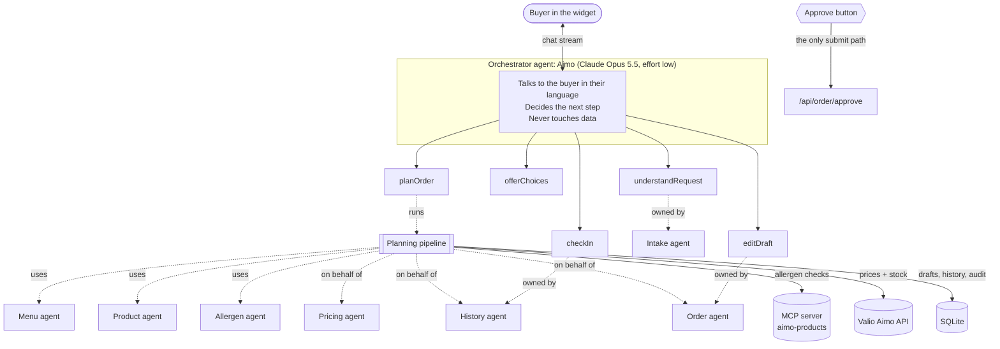
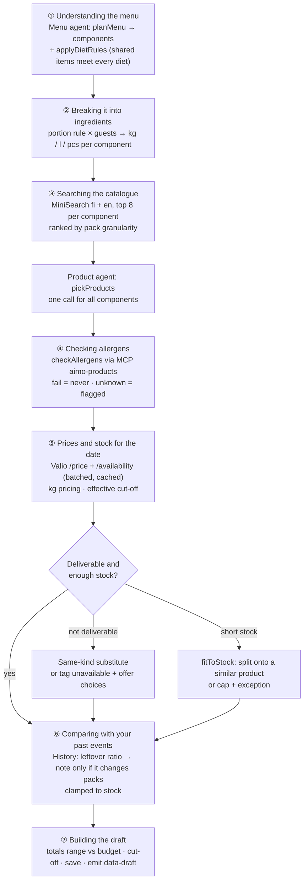

# Orchestrator, tools and MCP

How Aimo Planner's agents are wired: who talks to the buyer, which tools exist and who owns them, what the `aimo-products` MCP server exposes, and the steps the planning pipeline runs. For the wider system, see [ARCHITECTURE.md](ARCHITECTURE.md).

## 1. The big picture



**The rule:** agents reason, code computes. The orchestrator can only call the five delegate tools. Specialists use the model only where judgment is needed. Every price, stock figure, quantity, allergen verdict and history number comes from code over real data. No agent can submit an order; only the buyer's **Approve** button can.

## 2. Orchestrator tools

These are the only tools the orchestrator sees (`src/mastra/tools/*`). Each one is typed with zod, writes `data-*` stream parts the widget renders, and records its steps in the audit log under the owning specialist.

| Tool | Owner | What it does | UI it drives |
|---|---|---|---|
| `understandRequest` | Intake | Extracts date, guests, menu, budget and diets from free text in any language. Validates them (date at least tomorrow, guests 1–5000, cut-off). Only works before a draft exists. | `data-slots`: the slot chips |
| `offerChoices` | Orchestrator | Shows 2–6 quick-reply buttons plus an optional free-text field: missing slots, add-ons, stock shortfalls, substitutions. | `data-choices`: the buttons |
| `planOrder` | Menu → Product → Allergen → Pricing → History → Order | Runs the planning pipeline (section 4) and builds the priced draft. Called again with a new `deliveryDate` to re-plan. | `data-progress` (the animated checklist), then `data-draft` (the sheet) |
| `editDraft` | Order (calls Product, Allergen and Pricing as needed) | Turns typed changes into draft edits: set packs, remove, scale guests, history choice, swap, add, top-up for the remainder. Re-prices and reports problems. | `data-draft` with a diff (changed rows flash) |
| `checkIn` | History | Parses "about 5 kg chicken left, rice ran out" into a left / short amount per line. Saves nothing until the buyer confirms. | `data-checkin`: the editable table |

Buyer clicks (+/−, Use/Keep, remove, Approve, check-in Confirm) don't go through the model. They call `/api/draft`, `/api/order/approve` and `/api/checkin` directly.

## 3. Specialist agents

All run on `claude-opus-5-5` (`src/mastra/agents/*`). Model calls are injected through `src/mastra/specialists.ts`, so tests can stub them.

| Specialist | Model call (judgment) | Deterministic work done on its behalf | Effort |
|---|---|---|---|
| Intake | `extractIntake`: free text → slots | Date and guest validation, cut-off at intake | low |
| Menu | `planMenu`: dishes → components (portion category, diet variants, "needed for cooking" items) | Portion maths, diet rules for shared items, dropping orphan variants | medium |
| Product | `pickProducts`: best candidate per component, all components in one call | Candidate ranking (pack granularity, reliability, price for "cheaper") | medium |
| Allergen | `chooseUnknownFallback`: only when several candidates have unknown allergens | Allergen screening **via MCP**; unknown is never safe; diet coverage is one-way | low |
| Pricing | none | Valio prices and stock, effective cut-off, same-kind substitution, stock split or cap | low |
| History | `parseCheckIn`: leftover reply → numbers | Leftover ratios with fallbacks and recency weighting, clamped to stock | low |
| Order | `interpretEdit`: typed change → draft intents | Applying intents, re-pricing, budget, conflict detection | low |

A full plan costs about 3 model calls (menu, one product pick, plus the orchestrator turn) and takes about 20 s.

## 4. The planning pipeline (`planOrder` → `buildDraft`)

`src/mastra/pipeline/build-draft.ts`. Each step emits a progress event (the checklist in the widget) and writes audit entries.



What the steps guarantee:
- **Quantities:** always rounded up to whole packs, using minimum order steps normalised to packs.
- **Products sold by the kilo:** line price = per-kg price × piece weight, and stock is compared in kg.
- **Substitutes:** must be the same kind of product (name terms or category) and pass the same allergen constraints. They are never silent and always carry a reason in the buyer's language.
- **Resilience:** if a specialist call fails, the pipeline degrades (for example to the best catalogue match) instead of failing the whole plan. If Valio is down, the client serves cached prices and Approve refuses stale ones.

## 5. The MCP server: `aimo-products`

`src/mcp/aimo-products.ts`, built with Mastra's `MCPServer`. It serves the product catalogue index (17,546 products, `data/catalog.index.json`).

| MCP tool | Input | Returns |
|---|---|---|
| `searchProducts` | `query` (any language), optional `excludeAllergens`, `requireDiet`, `temperature`, `limit` | Ranked hits with match reasons; constraint-safe products first |
| `getProduct` | `id` | Pack size and unit, allergens, diet flags, delivery reliability, CO₂ per kg |
| `getAlternatives` | `id`, optional `limit` | Similar products (same category first), for substitutions |
| `getIngredients` | `id` | Ingredient text (allergens in CAPS, as in the source), parsed allergens and diet flags |
| `checkAllergens` | `ids[]`, `excludeAllergens`, `requireDiet` | Per product: `pass` / `fail` / `unknown`, conflicts, and quoted ingredient evidence |

**How the app uses it:** the pipeline's allergen step calls `checkAllergens` through Mastra's `MCPClient` over stdio (`src/mcp/client.ts` → `checkAllergensViaMcp`). The first call starts the server, which takes about 1.5 s and overlaps with the product pick; later calls take milliseconds. If the server can't start, the same tool runs in-process and one warning is logged. Product search and the re-checks during substitution and stock splits run in-process for speed.

**How an external agent uses it:** any MCP client can connect to the same server, which is the "open interface for purchasing agents" the challenge asks about.

```bash
npx tsx src/mcp/stdio.ts          # run from the repo root
```

Example MCP client config (Claude Desktop, Cursor and similar):

```json
{
  "mcpServers": {
    "aimo-products": {
      "command": "npx",
      "args": ["tsx", "src/mcp/stdio.ts"],
      "cwd": "/path/to/AimoValio-Junction2026"
    }
  }
}
```

Only catalogue and allergen data are exposed over MCP. Pricing, stock and ordering stay behind the app's own guarded flow, so no external agent can place an order. Exposing pricing, and ordering behind the same buyer approval, is the natural next step.

## 6. One turn, end to end


## 7. Where to look in the code

| Concern | File |
|---|---|
| Orchestrator instructions and tool list | `src/mastra/agents/orchestrator.ts` |
| Specialist prompts and model calls | `src/mastra/agents/*.ts`, `src/mastra/specialists.ts` |
| Delegate tools | `src/mastra/tools/*.ts` |
| Pipeline | `src/mastra/pipeline/build-draft.ts`, `reprice.ts`, `same-kind.ts`, `reasons.ts` |
| MCP server, client, stdio entry | `src/mcp/aimo-products.ts`, `client.ts`, `stdio.ts` |
| Stream parts and shared types | `src/contracts.ts` |
| Live smoke test (prints the tool sequence) | `npx tsx --env-file=.env.local scripts/agent-smoke.ts` |
